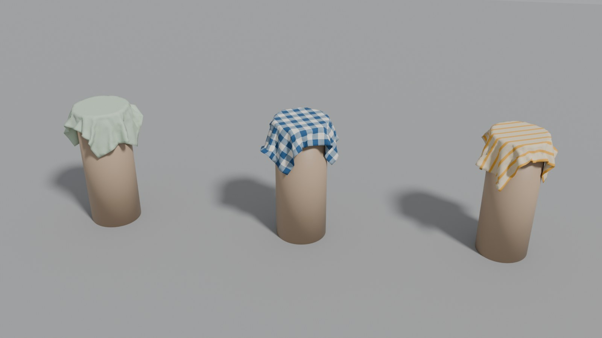

<h1 align="center">
  <picture>
    <source media="(prefers-color-scheme: dark)" srcset="https://raw.githubusercontent.com/drscaon/maillage/main/docs/images/logo-dark.svg">
    
  </picture>
</h1>

<p align="center"><strong>Realistic textile assets generator for Physical AI.</strong></p>

<p align="center">
  <a href="https://github.com/drscaon/maillage/actions/workflows/ci.yml"></a>
  <a href="https://pypi.org/project/maillage/"></a>
  
  
  <a href="https://primvaria.com"></a>
</p>

Maillage generates towels, tea towels, napkins, tablecloths, bed sheets,
cleaning cloths, bandanas, silk and knitted scarves and flags with real sizes, fabrics, masses and
patterns, meshed for cloth simulation and exported to **OpenUSD**. Every piece
is checked in **Blender** and in **MuJoCo** by a drape test: it imports, simulates
without exploding, stretches little, does not go through obstacles and comes
to rest. The scenes are also exported for **NVIDIA OmniPhysics** (Isaac Sim) as
surface deformables.

It is built for **Physical AI**: robots that fold laundry, lay a table or hand
over a towel are trained and tested in simulation, and they need many
different cloths, not one subdivided square; perception models need synthetic
images of crumpled and draped fabric with exact ground truth. Everything can
run on CPU. Maillage is part of [**Primvaria**](https://primvaria.com), with
[Granulaire](https://github.com/drscaon/granulaire) (granular assets),
[Filaire](https://github.com/drscaon/filaire) (cables) and
[Quincaillerie](https://github.com/drscaon/quincaillerie) (fasteners, cells
and holders), and follows the same approach: distributions instead of one
shape, measured outputs, honest limits.



*Waffle-cotton tea towels generated by Maillage (solid, gingham, striped),
imported into Blender and draped by the drape test. Render:
`maillage drop-test output/tea_towel --render`.*

## What it does

- Generates *N* distinct pieces of a preset (12 by default): format drawn from
  real retail sizes, size tolerance, corner rounding, an imperfect cut (wavy
  edges, slight skew), fabric and pattern.
- Meshes each piece for cloth solvers: near-equilateral triangles for any
  outline (rounded corners, round tablecloths), or a structured quad grid for
  rectangles (the topology of a woven fabric).
- Draws a procedural pattern (solid, end bands, stripes along or across,
  gingham, border, flag bands) as a PNG texture that follows the fabric, not the cut.
- **Measures** every mesh (area, perimeter, edge lengths, minimum angles) and
  derives the mass from the fabric's areal density.
- Exports an OpenUSD scene: meshes with UVs, a textured UsdPreviewSurface
  material, `hem` and `pin` primvars, and the fabric's physical properties as
  custom attributes.
- **Tests every piece in Blender** (`maillage drop-test`): import, cloth
  simulation, automatic checks, Cusick drape coefficient, the draped meshes
  exported back to OpenUSD and an optional Cycles render.
- **Exports and tests every piece in MuJoCo** (`maillage_<preset>.xml`, one
  flex cloth per piece; `maillage sim-test`), and **exports it for NVIDIA
  OmniPhysics** as surface deformables (`maillage_<preset>_omniphysics.usda`);
  see [Engines](https://github.com/drscaon/maillage/blob/main/docs/engines.md#engines).

## Installation

From PyPI:

```bash
pip install "maillage[render]"
```

From a clone, for development:

```bash
python -m venv .venv && source .venv/bin/activate
pip install -e ".[render]"        # add ",dev" for tests and linting
```

Requires Python 3.11+ and `usd-core` 26.5+ (the OpenUSD bindings). For the Blender drape test, either put Blender on the
PATH, or install Blender as a Python module (`pip install -e ".[blender]"`,
Python 3.13 only, as the `bpy` wheels exist for one Python version). Tested
with Blender 5.2; Blender 4.2 or later should work.

Earlier `usd-core` wheels generate the same files, but their OpenUSD
validators do not load (25.5 ships without the validator
libraries, 25.8 and 25.11 without the UsdPreviewSurface definitions), and CI
tests both 26.5 and the newest release.

## Usage

```bash
maillage list
maillage generate --preset tea_towel                     # 12 pieces, triangles
maillage generate --preset tablecloth --count 20 --seed 3
maillage generate --preset bath_towel --topology grid --vertices 2500
maillage generate --preset napkin --fabric silk --no-cut --no-color
maillage generate --preset tablecloth --format "140x180@2,round:150,oval:140x220"
maillage preview output/tea_towel                        # flat sheet (matplotlib)
maillage drop-test output/tea_towel --pieces 4 --render  # Blender drape test
maillage drop-test output/tea_towel --gif                # + animated GIF (Pillow)
maillage drop-test output/flag --wind 4 --render         # flags hang from a pole
```

`python -m maillage ...` works too. Without the `bpy` module or `blender` on
the PATH, `maillage drop-test` prints the command to run with your Blender:

```bash
blender -b -P "$(maillage blender-script)" -- output/tea_towel --render
```

The script does not import Maillage, so Blender's own Python needs nothing
installed. From Python:

```python
from maillage import Variations, generate_scene, write_outputs

towels = generate_scene("tea_towel", count=12, seed=1)
write_outputs(towels, "output")  # -> output/tea_towel/

# 40 cm linen squares with a perfect cut, 2,000 vertices each, quad grid
napkins = generate_scene(
    "napkin",
    count=6,
    fabric="linen",
    topology="grid",
    vertices=2000,
    variations=Variations(cut=False),
)
write_outputs(napkins, "output")

# tablecloths in your own sizes: a 140×180 rectangle twice as often as the rest
tablecloths = generate_scene("tablecloth", count=12, formats="140x180@2, round:150, oval:140x220")
write_outputs(tablecloths, "output")
```

Four short scripts in [`examples/`](https://github.com/drscaon/maillage/tree/main/examples)
show the rest, each explained by its own comments: a first pack and its
ground truth, one aspect switched off, reading the file with OpenUSD alone,
and the drape test in MuJoCo.

### Variations

Each aspect has its own random stream: turning one off leaves the others
unchanged (same shapes with plain colours, same colours with a perfect cut…).

| Option (CLI / Python `Variations`) | On (default) | Off |
|---|---|---|
| `--no-size` / `size=False` | format drawn, size within the preset's tolerance | first format, exact size |
| `--no-cut` / `cut=False` | wavy edges (0.3–6 mm) and skew (up to 1.5°) | perfect cut |
| `--no-corners` / `corners=False` | corner radius drawn | middle of the range |
| `--no-color` / `color=False` | pattern and colours drawn | first pattern, first colours |
| `--fabric NAME` / `fabric="linen"` (`Variations(fabric=False)`: first fabric) | fabric drawn from the preset's mix | one fabric for every piece |

## Outputs (per preset, under `output/<preset>/`)

| File | Content |
|---|---|
| `maillage_<preset>.usdc` | OpenUSD scene (Blender: File > Import > USD) |
| `maillage_<preset>_omniphysics.usda` | the same scene with NVIDIA OmniPhysics surface deformables (Omniverse, Isaac Sim 5+): an OpenUSD layer over the main file, see [Engines](https://github.com/drscaon/maillage/blob/main/docs/engines.md#engines) |
| `maillage_<preset>.xml` | the same scene as a MuJoCo model, one flex cloth per piece, see [Engines](https://github.com/drscaon/maillage/blob/main/docs/engines.md#engines) |
| `textures/<piece>.png` | pattern texture of each piece |
| `instances.csv` | one row per piece, read back from the file: its identity, **every drawn value** (`variation:<name>`) and **every measured value** (`measured:<name>`): the ground truth |
| `manifest.json` | what the pack is (contract, generator, version, preset, seed, aspects, files) and its summary: counts by fabric, pattern, shape and format; mass and mesh statistics |
| `sheet.png` | flat preview (`maillage preview`) |
| `drop_test/` | `drop_test.json`, `draped.usdc`, `drop_test.png`, `drop_test.gif` and `frames/` (`maillage drop-test`) |
| `sim_test/` | `sim_test.json` and the MuJoCo model of the test, `mujoco_drape.xml` (`maillage sim-test`) |

## Engines

Every file is OpenUSD with standard `UsdPhysics` schemas. Where each engine
stands, as on the [Primvaria engine matrix](https://primvaria.com/#engines):

| Engine | Status |
|---|---|
| OpenUSD validators (`usdchecker`) | **tested**: every preset, OmniPhysics layer included, in CI |
| Blender | **tested**: drape test of every preset (`maillage drop-test`) |
| MuJoCo | **tested**: flex export and drape test of every preset (`maillage sim-test`); the fabrics drape differently (`maillage fabric-test`) |
| NVIDIA OmniPhysics (Isaac Sim 5+) | surface deformables exported, structure checked, not simulated yet |

The main file is engine-neutral; engine-specific exports are read back from
it, so every engine sees the same piece. Stiffness values, exports and test
results: [Engines and drape tests](https://github.com/drscaon/maillage/blob/main/docs/engines.md).

## Limits

The short version; the full list is in [Limits and roadmap](https://github.com/drscaon/maillage/blob/main/docs/limits.md).

- Stiffness values are orders of magnitude from published ranges, **not
  calibrated** against measurements of these fabrics.
- Fabrics drape differently in MuJoCo; **in Blender they drape alike**.
- The OmniPhysics layer is checked for structure, **not simulated yet**.
- Flat pieces only: no garments, no folded or crumpled starting states.

## Development

```bash
git clone https://github.com/drscaon/maillage.git && cd maillage
pip install -e ".[dev]"
pytest
```

Conventions and continuous integration: [Development](https://github.com/drscaon/maillage/blob/main/docs/development.md).

## Documentation

| Page | What it holds |
|---|---|
| [Usage in depth](https://github.com/drscaon/maillage/blob/main/docs/usage.md) | The preset list, fabrics, formats, mesh options and how a piece is built. |
| [OpenUSD layout and contract](https://github.com/drscaon/maillage/blob/main/docs/openusd.md) | How a piece is laid out in the file, the ground and physics scene, OpenUSD compliance, and what the Primvaria contract writes on every piece. |
| [Engines and drape tests](https://github.com/drscaon/maillage/blob/main/docs/engines.md) | The engine-neutral stiffness, the MuJoCo and OmniPhysics exports, and the drape tests in Blender and MuJoCo with their results. |
| [Limits and roadmap](https://github.com/drscaon/maillage/blob/main/docs/limits.md) | Everything Maillage does not do or has not verified, stated plainly, and what comes next. |
| [Development](https://github.com/drscaon/maillage/blob/main/docs/development.md) | Branch and release conventions, continuous integration. |

## License

[MIT](https://github.com/drscaon/maillage/blob/main/LICENSE) © 2026 Daniel Régis Sarmento Caon

The logo is set in IBM Plex Sans (SIL Open Font License 1.1), outlined into
paths, so it displays without the font installed.

---

Maillage is part of [**Primvaria**](https://primvaria.com), physics-ready variability for Physical AI, in OpenUSD: `pip install primvaria` installs the whole suite ([source](https://github.com/drscaon/primvaria)).
