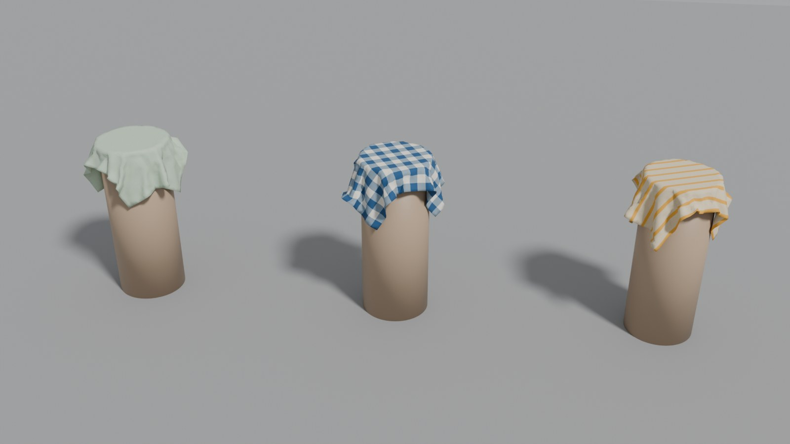
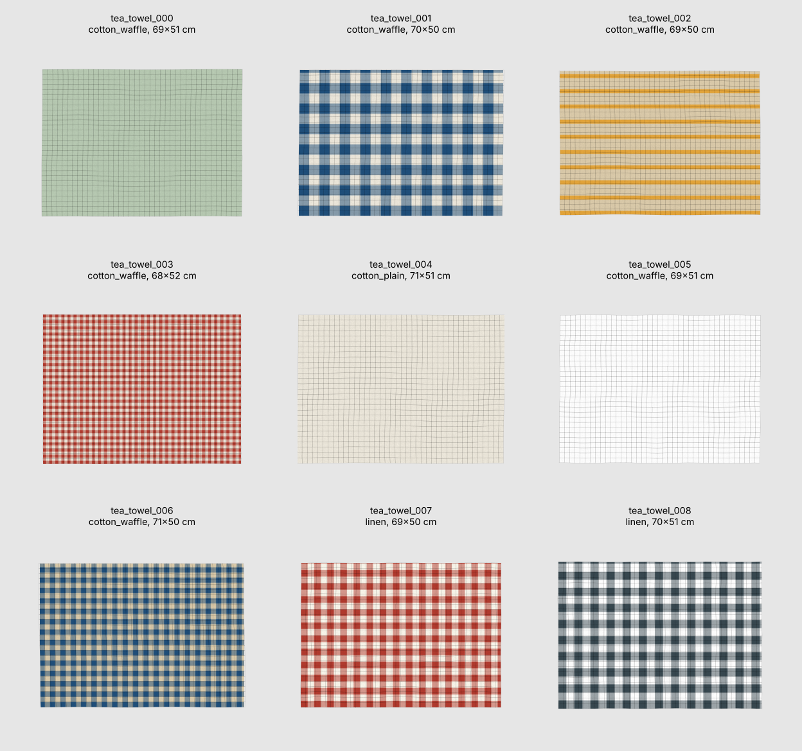
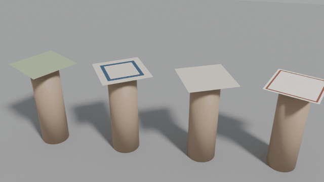
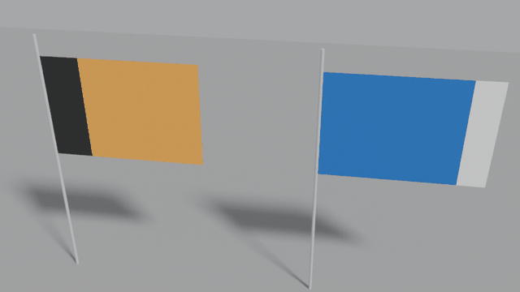

<h1 align="center">
  <picture>
    <source media="(prefers-color-scheme: dark)" srcset="docs/images/logo-dark.svg">
    
  </picture>
</h1>

<p align="center"><strong>Realistic textile assets generator for Physical AI.</strong></p>

<p align="center">
  <a href="https://github.com/drscaon/maillage/actions/workflows/ci.yml"></a>
  
  
</p>

Maillage generates towels, tea towels, napkins, tablecloths, bed sheets,
cleaning cloths, scarves and flags with real sizes, fabrics, masses and
patterns, meshed for cloth simulation and exported to **OpenUSD**. Every piece
is checked in **Blender** by a drape test: it imports, simulates without
exploding, stretches little, does not go through obstacles and comes to rest.

It is built for **Physical AI**: robots that fold laundry, lay a table or hand
over a towel are trained and tested in simulation, and they need many
different cloths, not one subdivided square; perception models need synthetic
images of crumpled and draped fabric with exact ground truth. Everything runs
on CPU. Maillage is the sister project of
[Granulaire](https://github.com/drscaon/granulaire) (granular assets) and
follows the same approach: distributions instead of one shape, measured
outputs, honest limits.



*Waffle-cotton tea towels generated by Maillage (solid, gingham, striped),
imported into Blender and draped by the drape test. Render:
`maillage drop-test output/tea_towel --render`.*

## What it does

- Generates *N* distinct pieces of a preset (12 by default): format drawn from
  real retail sizes, size tolerance, corner rounding, an imperfect cut (wavy
  edges, slight skew), fabric and pattern.
- Meshes each piece for cloth solvers: near-equilateral triangles for any
  outline (rounded corners, round tablecloths), or a structured quad grid for
  rectangles (the topology of a woven fabric).
- Draws a procedural pattern (solid, end bands, stripes, gingham, border, flag
  bands) as a PNG texture that follows the fabric, not the cut.
- **Measures** every mesh (area, perimeter, edge lengths, minimum angles) and
  derives the mass from the fabric's areal density.
- Exports an OpenUSD scene: meshes with UVs, a textured UsdPreviewSurface
  material, `hem` and `pin` primvars, and the fabric's physical properties as
  custom attributes.
- **Tests every piece in Blender** (`maillage drop-test`): import, cloth
  simulation, automatic checks, Cusick drape coefficient, the draped meshes
  exported back to OpenUSD and an optional Cycles render.

## Installation

```bash
python -m venv .venv && source .venv/bin/activate
pip install -e ".[render]"        # add ",dev" for tests and linting
```

Requires Python 3.10+. For the Blender drape test, either put Blender on the
PATH, or install Blender as a Python module (`pip install -e ".[blender]"`,
Python 3.13 only, as the `bpy` wheels exist for one Python version). Tested
with Blender 5.2; Blender 4.2 or later should work.

## Usage

```bash
maillage list
maillage generate --preset tea_towel                     # 12 pieces, triangles
maillage generate --preset tablecloth --count 20 --seed 3
maillage generate --preset bath_towel --topology grid --vertices 2500
maillage generate --preset napkin --fabric silk --no-cut --no-color
maillage preview output/tea_towel                        # flat sheet (matplotlib)
maillage drop-test output/tea_towel --pieces 4 --render  # Blender drape test
maillage drop-test output/tea_towel --gif                # + animated GIF (Pillow)
maillage drop-test output/flag --wind 4 --render         # flags hang from a pole
```

`python -m maillage ...` works too. Without the `bpy` module or `blender` on
the PATH, `maillage drop-test` prints the command to run with your Blender:

```bash
blender -b -P "$(maillage blender-script)" -- output/tea_towel --render
```

The script does not import Maillage, so Blender's own Python needs nothing
installed. From Python:

```python
from maillage import Variations, generate_scene, write_outputs

towels = generate_scene("tea_towel", count=12, seed=1)
write_outputs(towels, "output")  # -> output/tea_towel/

# 40 cm linen squares with a perfect cut, 2,000 vertices each, quad grid
napkins = generate_scene(
    "napkin",
    count=6,
    fabric="linen",
    topology="grid",
    vertices=2000,
    variations=Variations(cut=False),
)
write_outputs(napkins, "output")
```

### Presets

| Category | Preset | Formats (cm) | Fabrics |
|---|---|---|---|
| Bath | `bath_towel` | 70×140, 90×150 | cotton terry |
| | `hand_towel` | 50×100, 40×60 | cotton terry |
| | `washcloth` | 30×30 | cotton terry |
| Kitchen | `tea_towel` | 50×70, 45×65 | waffle cotton, linen, plain cotton |
| Table | `napkin` | 40×40, 50×50 | linen, plain cotton |
| | `tablecloth` | 140×180, 140×240, round ⌀150, oval 140×200 | plain cotton, linen |
| Bedding | `bed_sheet` | 180×290, 240×300, 270×310 | percale, linen |
| Cleaning | `microfiber_cloth` | 40×40, 30×30 | microfiber |
| Accessories | `bandana` | 55×55 | plain cotton |
| | `silk_scarf` | 90×90, 50×160 | silk |
| Outdoor | `flag` | 100×150, 60×90 (hung by the hoist) | polyester knit |

Sizes are common retail formats; values are realistic orders of magnitude,
not measurements of a specific product. Flags use generic two or three band
designs with random colours (no national flags).

### Fabrics

| Fabric | Areal density | Thickness | Friction |
|---|---|---|---|
| `cotton_terry` | 450 g/m² | 4 mm | 0.8 |
| `cotton_waffle` | 220 g/m² | 1.5 mm | 0.6 |
| `cotton_plain` | 140 g/m² | 0.3 mm | 0.5 |
| `cotton_percale` | 120 g/m² | 0.25 mm | 0.5 |
| `linen` | 180 g/m² | 0.35 mm | 0.55 |
| `denim` | 400 g/m² | 0.7 mm | 0.6 |
| `fleece` | 250 g/m² | 3 mm | 0.8 |
| `microfiber` | 300 g/m² | 2 mm | 0.9 |
| `polyester_knit` | 115 g/m² | 0.2 mm | 0.4 |
| `silk` | 60 g/m² | 0.1 mm | 0.3 |

`--fabric` gives every piece the same fabric, whatever the preset's mix.

### Variations

Each aspect has its own random stream: turning one off leaves the others
unchanged (same shapes with plain colours, same colours with a perfect cut…).

| Option (CLI / Python `Variations`) | On (default) | Off |
|---|---|---|
| `--no-size` / `size=False` | format drawn, size within the preset's tolerance | first format, exact size |
| `--no-cut` / `cut=False` | wavy edges (0.3–6 mm) and skew (up to 1.5°) | perfect cut |
| `--no-corners` / `corners=False` | corner radius drawn | middle of the range |
| `--no-color` / `color=False` | pattern and colours drawn | first pattern, first colours |
| `--fabric NAME` / `fabric="linen"` (`Variations(fabric=False)`: first fabric) | fabric drawn from the preset's mix | one fabric for every piece |

### Mesh

| Option | Default | Effect |
|---|---|---|
| `--topology tri` | ✓ | near-equilateral triangles (Delaunay on a jittered hexagonal lattice, outline sampled at the same spacing); any outline; minimum angles above ~20° |
| `--topology grid` | | structured quads stretched over the four cut edges (Coons patch); rectangles only, sharp corners; round formats are skipped |
| `--vertices N` | 1500 | target vertices per piece, whatever its size |
| `--count N`, `--seed S` | 12, 1 | number of pieces, random seed; same options and seed give the same pieces |



*`maillage preview output/tea_towel` on a grid-topology set: the texture is
drawn over each piece and the mesh shown on top; the wavy grid lines are the
imperfect cut, spread across the piece.*

## Outputs (per preset, under `output/<preset>/`)

| File | Content |
|---|---|
| `maillage_<preset>.usdc` | OpenUSD scene (Blender: File > Import > USD) |
| `textures/<piece>.png` | pattern texture of each piece |
| `pieces.csv` | per piece: fabric, shape, pattern, size, corner radius, mass, mesh metrics |
| `summary.json` | counts by fabric, pattern and shape; mass and mesh statistics |
| `sheet.png` | flat preview (`maillage preview`) |
| `drop_test/` | `drop_test.json`, `draped.usdc`, `drop_test.png`, `drop_test.gif` and `frames/` (`maillage drop-test`) |

### OpenUSD layout

Z up, metres, kilograms. `/World` is the default prim.

```
/World
  /Looks/<piece>      UsdPreviewSurface + UsdUVTexture (textures/<piece>.png)
  /Cloths/<piece>     UsdGeom.Mesh, flat on the ground, laid out in rows
  /Ground             collision ground (UsdPhysics.CollisionAPI)
```

Each cloth mesh has `subdivisionScheme = none`, is double sided, and carries:

| Property | Content |
|---|---|
| `primvars:st` | texture coordinates (vertex) |
| `primvars:hem` | 1 on the hemmed band along the edges, 0 elsewhere (vertex) |
| `primvars:pin` | 1 on pinned vertices: the hoist corners of a flag (vertex) |
| `primvars:displayColor` | mean colour of the texture |
| `maillage:fabric`, `maillage:pattern`, `maillage:shape` | what the piece is |
| `maillage:arealDensity`, `maillage:mass`, `maillage:thickness`, `maillage:friction` | physical properties (SI units) |
| `maillage:nominalSize`, `maillage:size`, `maillage:cornerRadius` | retail and actual size (m) |
| `maillage:hemBendingFactor` | how much stiffer the hem is in bending |
| `maillage:blender:*` | stiffness for Blender's cloth solver, for 1 cm edges (see [Blender values](#blender-values)) |

OpenUSD has no standard schema for cloth simulation (`UsdPhysics` covers
rigid bodies and joints), so these properties are custom attributes. Blender's
USD importer reads the geometry, UVs, material, texture and the `hem` and
`pin` primvars (as mesh attributes); the drape test reads the `maillage:*`
attributes with the OpenUSD bindings shipped with Blender.

## Blender drape test

`maillage drop-test` imports the scene into Blender and, for each tested
piece:

1. sets up Blender's cloth solver from the `maillage:*` attributes: stiffness
   rescaled to the mesh and the piece's real mass, stiffer bending on the hem,
   collisions and self-collisions;
2. **drape**: lays the piece flat on a round pedestal (diameter 60 % of the
   shorter side), its centre clamped as between the two discs of a Cusick
   drape tester, and lets the rest fall; **hang**: a flag hangs from its two
   hoist corners on a pole, optionally in the wind;
3. simulates 5 s (120 frames at 24 fps);
4. checks the result and writes `drop_test.json`:

| Check | Pass when |
|---|---|
| finite | no invalid coordinate |
| stretch | 99 % of the edges stretched by less than 10 %, none by more than 60 % |
| penetration | less than 0.5 % of the vertices inside the pedestal or under the floor |
| at rest | (drape) fastest vertex below 10 cm/s at the end |

It also measures the **drape coefficient** of each draped piece, as in the
Cusick test: (projected area − pedestal area) / (flat area − pedestal area),
from 1 (stays flat) to 0 (hangs straight down). The draped meshes are exported
to `draped.usdc` with their `maillage:*` attributes copied back: ready-to-use
draped assets.

### Results

Indicative results of `maillage drop-test` on three pieces of each preset
(seed 1, 1,500 vertices per piece, 120 frames, Blender 5.2):

| Preset | Mass (g) | Vertices | Scenario | Drape coefficient | Stretch (p99) | Result |
|---|---|---|---|---|---|---|
| `bath_towel` | 429–450 | 1563–1582 | drape | 0.22–0.23 | 3.1–3.7 % | 3/3 pass |
| `hand_towel` | 219–229 | 1563–1585 | drape | 0.22–0.26 | 2.6–3.6 % | 3/3 pass |
| `washcloth` | 39–41 | 1562–1572 | drape | 0.40–0.49 | 4.2–5.1 % | 3/3 pass |
| `tea_towel` | 75–78 | 1549–1570 | drape | 0.28 | 2.8–2.9 % | 3/3 pass |
| `napkin` | 28–29 | 1559–1578 | drape | 0.36–0.38 | 2.2–2.6 % | 3/3 pass |
| `tablecloth` | 356–470 | 1564–1572 | drape | 0.20–0.25 | 3.1–4.0 % | 3/3 pass |
| `bed_sheet` | 636–863 | 1553–1573 | drape | 0.28–0.37 | 3.0–3.1 % | 3/3 pass |
| `microfiber_cloth` | 47–49 | 1554–1575 | drape | 0.37–0.41 | 2.2–2.4 % | 3/3 pass |
| `bandana` | 42–43 | 1558–1576 | drape | 0.30–0.33 | 2.5–3.1 % | 3/3 pass |
| `silk_scarf` | 48–49 | 1560–1579 | drape | 0.25–0.27 | 3.1–3.4 % | 3/3 pass |
| `flag` | 170–174 | 1551–1567 | hang | — | 1.9–2.4 % | 3/3 pass |

No piece went through the pedestal or the floor. The drape coefficient
depends on the shape of the piece as much as on the fabric (a long towel
hangs further past a pedestal sized on its short side), so it compares
pieces of one preset, not presets with each other. To compare fabrics, the
same 40 cm square was draped in each (`maillage generate --preset napkin
--no-size --no-cut --fabric silk,polyester_knit,cotton_plain,linen,cotton_terry,denim`):

| Fabric | silk | polyester knit | plain cotton | linen | cotton terry | denim |
|---|---|---|---|---|---|---|
| Mass of the square | 10 g | 18 g | 22 g | 29 g | 72 g | 64 g |
| Drape coefficient | 0.37 | 0.35 | 0.42 | 0.40 | 0.38 | 0.42 |

In this version the fabrics differ in mass, thickness, friction and look
much more than in drape: the drape coefficients stay within 0.35–0.42,
where real silk and denim are far apart (see [Limits](#limits)).



*Silk, plain cotton, linen and denim squares falling onto the clamped
pedestals, slowed down twice: `maillage generate --preset napkin --count 4 --fabric
silk,cotton_plain,linen,denim` then `maillage drop-test output/napkin --frames 40
--gif --gif-step 1`.*



*Flags hung by their hoist corners in the wind: `maillage drop-test
output/flag --wind 4 --gif`.*

### Blender values

Blender's cloth stiffness acts per edge and is not divided by the vertex mass,
so the same numbers make a fabric stiffer or softer depending on the mesh
resolution. Maillage stores the stiffness for a reference mesh with 1 cm edges
and the real mass, and the drape test rescales it: tension and shear with the
edge length, bending unchanged, air damping with the area per vertex. The
solver itself runs with Blender's usual 0.3 kg vertex mass and every stiffness
and damping multiplied by the same factor, which leaves the motion unchanged
and keeps Blender's solver in the range its tolerances are tuned for.

Tension gives about 3 % stretch when a piece drapes; bending is smaller for
softer fabrics. **The values are not calibrated** against measured fabric
properties.

## Method in brief

1. **Outline.** A rectangle with rounded corners or an ellipse, parametrised
   by arc length. The cut adds a smooth normal displacement (sum of a few
   sines along the perimeter: long gentle deviations plus a small wobble) and
   a slight shear.
2. **Mesh.** *tri*: the outline is sampled at the target edge length (sharp
   corners kept, roundings below the resolution merged into one vertex), the
   inside filled with a jittered hexagonal lattice kept at least half an edge
   away from the outline, then a Delaunay triangulation clipped to the
   outline. *grid*: transfinite (Coons) interpolation of the four cut edges.
3. **Fabric and mass.** The fabric is drawn from the preset's mix; the mass is
   the measured area times the areal density.
4. **Hem and pins.** Vertices within the hem width of the outline get
   `hem = 1`; for flags, vertices near the two hoist corners get `pin = 1`.
5. **Pattern.** Parameters drawn per piece (colours from the preset's
   palettes, periods, band widths), rendered on the nominal rectangle with a
   faint weave noise; texture coordinates follow the fabric, so a skewed or
   wavy cut shows as a pattern not quite parallel to the edge, as on real
   pieces.

## Limits

- **Blender only, so far.** The drape test validates the assets in Blender's
  cloth solver. Nothing is exported yet for NVIDIA OmniPhysics deformables
  (Isaac Sim) or MuJoCo flex; the geometry and physical attributes are there,
  the engine-specific schemas are not.
- **Not calibrated, and fabrics drape alike.** Stiffness values give
  plausible, consistent behaviour, not measured behaviour (no Kawabata or
  Cusick measurements behind them), and the bending values are kept low:
  the drape coefficients of the fabrics stay close to one another.
- **Flat pieces only.** No garments (sewn panels), no holes or grommets (a
  flag is pinned at its hoist corners instead), no folded or crumpled starting
  states, no wet cloth.
- **Textures are procedural.** Patterns are clean and regular; no prints,
  logos, stains or wear.

## Roadmap

1. Pre-draped and crumpled states as OpenUSD variants (the drape test already
   exports draped meshes), and folded states for laundry-folding tasks.
2. Engine-neutral physical stiffness (tensile and bending rigidity in SI
   units) with per-engine mappings, starting with OmniPhysics surface
   deformables.
3. Calibration against published fabric measurements.
4. Simple garments from sewing patterns.

## Development

The project follows **GitHub Flow**:

1. `main` is always releasable and protected: changes reach it only through
   pull requests, nobody pushes to it directly.
2. Every change starts on a short-lived branch from `main`, named after its
   type: `feat/<name>`, `fix/<name>`, `docs/<name>`, `ci/<name>`, …
3. Push the branch and open a pull request into `main`; CI runs on it.
4. Merge when CI is green, then delete the branch.

Releasing is a change like any other: on a `chore/release-X.Y.Z` branch, bump
`version` in `pyproject.toml` and move the `Unreleased` entries of
`CHANGELOG.md` under the new version; merge the pull request, then tag
`vX.Y.Z` on `main` (or create the release on the GitHub web page with that new
tag). The release workflow builds the packages and attaches them.

A versioned `pre-push` hook refuses direct pushes to `main`. Enable it once per
clone with `git config core.hooksPath .githooks` (emergency override:
`ALLOW_MAIN_PUSH=1 git push`).

### Continuous integration

GitHub Actions runs these workflows (`.github/workflows/`):

| Workflow | When | What |
|---|---|---|
| `ci.yml` | every push to `main`, every pull request | `ruff check` and `ruff format --check`; `pytest` on Python 3.10–3.13 (Linux) and 3.12 (macOS, Windows); a command-line smoke test; **the Blender drape test of every preset** with the `bpy` module (Python 3.13, Linux), reports kept as a run artifact; build the wheel and sdist, `twine check`, install the wheel in a clean environment. |
| `release.yml` | a pushed tag `v*` | checks the tag matches the version in `pyproject.toml`, tests, builds, then creates the GitHub release with the packages attached and the notes taken from `CHANGELOG.md`. Versions with `a`, `b` or `rc` are marked as pre-releases. |
| Dependabot | monthly | pull requests to update the GitHub Actions and the Python dependencies. |

Ruff is pinned in CI so that a new ruff release cannot fail the build on
unchanged code; update the pin and run `ruff format .` together.

## License

[MIT](LICENSE) © 2026 Daniel Régis Sarmento Caon

The logo is set in IBM Plex Sans (SIL Open Font License 1.1), outlined into
paths, so it displays without the font installed.
