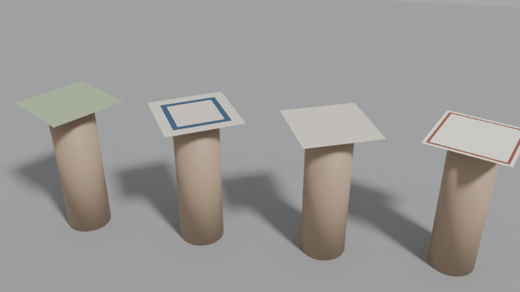
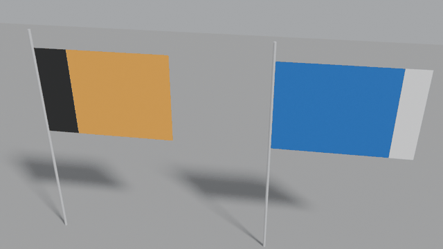

# Engines and drape tests

The engine-neutral stiffness, the MuJoCo and OmniPhysics exports, and the drape tests in Blender and MuJoCo with their results.

Part of the [Maillage](../README.md) documentation.

## Blender drape test

`maillage drop-test` imports the scene into Blender and, for each tested
piece:

1. sets up Blender's cloth solver from the `maillage:*` attributes: stiffness
   rescaled to the mesh and the piece's real mass, stiffer bending on the hem,
   collisions and self-collisions;
2. **drape**: lays the piece flat on a round pedestal (diameter 60 % of the
   shorter side), its centre clamped as between the two discs of a Cusick
   drape tester, and lets the rest fall; **hang**: a flag hangs from its two
   hoist corners on a pole, optionally in the wind;
3. simulates 5 s (120 frames at 24 fps);
4. checks the result and writes `drop_test.json`:

| Check | Pass when |
|---|---|
| finite | no invalid coordinate |
| stretch | 99 % of the edges stretched by less than 10 %, none by more than 60 % |
| penetration | less than 0.5 % of the vertices inside the pedestal or under the floor |
| at rest | (drape) fastest vertex below 10 cm/s at the end |

It also measures the **drape coefficient** of each draped piece, as in the
Cusick test: (projected area − pedestal area) / (flat area − pedestal area),
from 1 (stays flat) to 0 (hangs straight down). The draped meshes are exported
to `draped.usdc` with their `maillage:*` attributes copied back: ready-to-use
draped assets.

### Results

Indicative results of `maillage drop-test` on three pieces of each preset
(seed 1, ~1,500 vertices per piece, 120 frames, Blender 5.2):

| Preset | Mass (g) | Vertices | Scenario | Drape coefficient | Stretch (p99) | Result |
|---|---|---|---|---|---|---|
| `bath_towel` | 429–450 | 1563–1582 | drape | 0.22–0.23 | 3.1–3.7 % | 3/3 pass |
| `hand_towel` | 219–229 | 1563–1585 | drape | 0.22–0.26 | 2.6–3.6 % | 3/3 pass |
| `washcloth` | 39–41 | 1562–1572 | drape | 0.40–0.49 | 4.2–5.1 % | 3/3 pass |
| `tea_towel` | 75–78 | 1549–1570 | drape | 0.28 | 2.8–2.9 % | 3/3 pass |
| `napkin` | 28–29 | 1559–1578 | drape | 0.36–0.38 | 2.2–2.6 % | 3/3 pass |
| `tablecloth` | 356–470 | 1564–1572 | drape | 0.20–0.25 | 3.1–4.0 % | 3/3 pass |
| `bed_sheet` | 636–863 | 1553–1573 | drape | 0.28–0.37 | 3.0–3.1 % | 3/3 pass |
| `microfiber_cloth` | 47–49 | 1554–1575 | drape | 0.37–0.41 | 2.2–2.4 % | 3/3 pass |
| `bandana` | 42–43 | 1558–1576 | drape | 0.30–0.33 | 2.5–3.1 % | 3/3 pass |
| `silk_scarf` | 48–49 | 1560–1579 | drape | 0.25–0.27 | 3.1–3.4 % | 3/3 pass |
| `scarf` | 134–189 | 1608–1621 | drape | 0.10–0.13 | 2.6–2.8 % | 3/3 pass |
| `flag` | 170–174 | 1551–1567 | hang | — | 1.9–2.4 % | 3/3 pass |

No piece went through the pedestal or the floor. The drape coefficient
depends on the shape of the piece as much as on the fabric (a long towel
hangs further past a pedestal sized on its short side), so it compares
pieces of one preset, not presets with each other. To compare fabrics, the
same 40 cm square was draped in each (`maillage generate --preset napkin
--no-size --no-cut --fabric silk,polyester_knit,cotton_plain,linen,cotton_terry,denim`):

| Fabric | silk | polyester knit | plain cotton | linen | cotton terry | denim |
|---|---|---|---|---|---|---|
| Mass of the square | 10 g | 18 g | 22 g | 29 g | 72 g | 64 g |
| Drape coefficient | 0.37 | 0.35 | 0.42 | 0.40 | 0.38 | 0.42 |

In Blender the fabrics differ in mass, thickness, friction and look much
more than in drape: the drape coefficients stay within 0.35–0.42, where real
silk and denim are far apart (see the [roadmap](limits.md#roadmap)). In MuJoCo, with
the engine-neutral stiffness, they do not drape alike: see the
[fabric drape test](#fabric-drape-test).



*Silk, plain cotton, linen and denim squares falling onto the clamped
pedestals, slowed down twice: `maillage generate --preset napkin --count 4 --fabric
silk,cotton_plain,linen,denim` then `maillage drop-test output/napkin --frames 40
--gif --gif-step 1`.*



*Flags hung by their hoist corners in the wind: `maillage drop-test
output/flag --wind 4 --gif`.*

### Blender values

Blender's cloth stiffness acts per edge and is not divided by the vertex mass,
so the same numbers make a fabric stiffer or softer depending on the mesh
resolution. Maillage stores the stiffness for a reference mesh with 1 cm edges
and the real mass, and the drape test rescales it: tension and shear with the
edge length, bending unchanged, air damping with the area per vertex. The
solver itself runs with Blender's usual 0.3 kg vertex mass and every stiffness
and damping multiplied by the same factor, which leaves the motion unchanged
and keeps Blender's solver in the range its tolerances are tuned for.

Tension gives about 3 % stretch when a piece drapes; bending is smaller for
softer fabrics, and kept low for all of them (see the
[roadmap](limits.md#roadmap)). **The values are not calibrated** against measured
fabric properties.

## Engines

Every file is OpenUSD with standard `UsdPhysics` schemas. Where each engine
stands, as on the [Primvaria engine matrix](https://primvaria.com/#engines):

| Engine | Status |
|---|---|
| OpenUSD validators (`usdchecker`) | **tested**: every preset, OmniPhysics layer included, in CI |
| Blender | **tested**: drape test of every preset (`maillage drop-test`) |
| MuJoCo | **tested**: flex export and drape test of every preset (`maillage sim-test`); the fabrics drape differently (`maillage fabric-test`) |
| NVIDIA OmniPhysics (Isaac Sim 5+) | surface deformables exported, structure checked, not simulated yet |

The main file is engine-neutral; engine-specific exports are read back from
it, so every engine sees the same piece.

**Engine-neutral stiffness.** Each fabric has a tensile (membrane) stiffness
K in N/m, a bending rigidity B in N·m and a Poisson's ratio: orders of
magnitude from published ranges (B from 1e-6 N·m for silk to 1e-4 N·m for
denim; K from 1e2 N/m for a knitted scarf to a few 1e3 N/m for wovens), not
measurements. Shell models (MuJoCo, OmniPhysics) take a Young's modulus E and
a thickness t; the pair with E·t = K and E·t³ / 12(1 − ν²) = B gives both
exactly. That t is a bending thickness, not the fabric's real thickness:
fabrics bend far more easily than a solid plate of the same thickness.

| Engine | Export | Tested |
|---|---|---|
| Blender | the main file, through Blender's USD importer, with the `maillage:blender:*` stiffness | **yes**: `maillage drop-test`, every preset in CI |
| MuJoCo | `maillage_<preset>.xml`: one flex per piece (`flexcomp`, triangle shell, `elastic2d="both"`), mass, friction | **yes**: `maillage sim-test`, every preset in CI |
| NVIDIA OmniPhysics (Isaac Sim 5+) | `maillage_<preset>_omniphysics.usda`: surface deformables (`OmniPhysicsDeformableBodyAPI`, `OmniPhysicsSurfaceDeformableSimAPI`, `OmniPhysicsSurfaceDeformableMaterialAPI`), faces split into triangles | **structure only** (`python -m maillage.omniphysics`, OpenUSD validators): not simulated, OmniPhysics needs an NVIDIA RTX GPU |

### MuJoCo drape test

```bash
pip install "maillage[sim]"
maillage sim-test output/tea_towel --pieces 4
```

The same scenario and checks as the [Blender drape test](#blender-drape-test),
built from the OpenUSD file only: drape on a clamped pedestal (or hang from
the pinned vertices), 5 s, then finite values, stretch, penetration, at rest;
plus **mass** (the flex's mass is the file's) and **solver** (no MuJoCo
warning). The drape coefficient is measured.

MuJoCo settings, found with the test (MuJoCo 3.17; CI runs it on MuJoCo 4): the `discrete` integrator
(the only one that integrates flex elasticity implicitly), a 0.5 ms time step
(smaller when the membrane is stiff for the vertex mass, as for a small linen
napkin), the CG solver with a tight tolerance. MuJoCo cannot put air drag on
flex vertices in the XML: the test applies it as a force, 1 N·s/m³ per unit
of cloth area, the order of real air drag at draping speeds. Not modelled in
MuJoCo: self-collision, the stiffer hem (one stiffness per flex), wind.

### Fabric drape test

```bash
maillage fabric-test                                  # every fabric, about 4 minutes on one CPU
maillage fabric-test --fabric silk,cotton_plain,denim
```

Do the fabrics drape differently, as real ones do? This drapes the same
sample of each fabric in MuJoCo, a 30 cm disc on an 18 cm pedestal as in a
Cusick drape tester, each in its own simulation, and measures its drape
coefficient (1: the disc stays flat; 0: it hangs straight down). MuJoCo
4.0.1, 300 vertices, 4 s:

| Fabric | Bending length | Tensile stiffness | Drape coefficient |
|---|---|---|---|
| `polyester_knit` | 1.10 cm | 600 N/m | 0.51 |
| `silk` | 1.19 cm | 300 N/m | 0.54 |
| `microfiber` | 1.72 cm | 500 N/m | 0.57 |
| `wool_knit` | 2.06 cm | 150 N/m | 0.61 |
| `fleece` | 2.01 cm | 200 N/m | 0.62 |
| `cotton_waffle` | 1.91 cm | 800 N/m | 0.63 |
| `cotton_terry` | 2.08 cm | 600 N/m | 0.64 |
| `cotton_plain` | 1.63 cm | 1500 N/m | 0.67 |
| `cotton_percale` | 1.50 cm | 1500 N/m | 0.67 |
| `linen` | 2.04 cm | 2500 N/m | 0.74 |
| `denim` | 3.13 cm | 4000 N/m | 0.83 |

The bending length is Pierce's, (bending rigidity / weight per unit
area)^(1/3): the length over which a fabric bends under its own weight. The
drape coefficient rises with it, and with the tensile stiffness: to drape in
folds a disc must also shear in its plane, which knits (low tensile
stiffness) do more easily than wovens. That is the dependence Cusick found on
real fabrics, on bending length and shear stiffness
([Cusick, 1965](https://typeset.io/papers/46-the-dependence-of-fabric-drape-on-bending-and-shear-3ppgh8xdba)).

The test passes when every sample passes the checks of the drape test, silk,
plain cotton and denim drape in that order at least 0.05 apart, and the
fabrics spread over at least 0.2 (here 0.32). CI runs it on every fabric.

What it does not show: the values are not calibrated, so a fabric's
coefficient is not the one a Cusick tester would measure on it, and MuJoCo
has no self-collision here, so folds can pass through each other. The mesh
matters within about ±0.04: silk gives 0.52 to 0.59 and denim 0.83 to 0.89
between 300 and 1200 vertices, which leaves the order and the spread
unchanged.

### OmniPhysics layer

Open `maillage_<preset>_omniphysics.usda` in Omniverse or Isaac Sim: it
sublayers the main file and adds a physics scene, the deformable-body and
surface-simulation schemas on each cloth mesh (the mesh is both the body root
and its simulation mesh), rest shape and triangles, and one physics material
per fabric (Young's modulus, surface thickness, Poisson's ratio, density,
friction). Not exported yet: the pinned vertices of a flag (they need an
attachment) and the stiffer hem.
