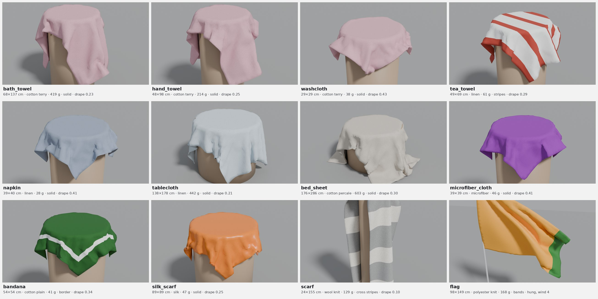
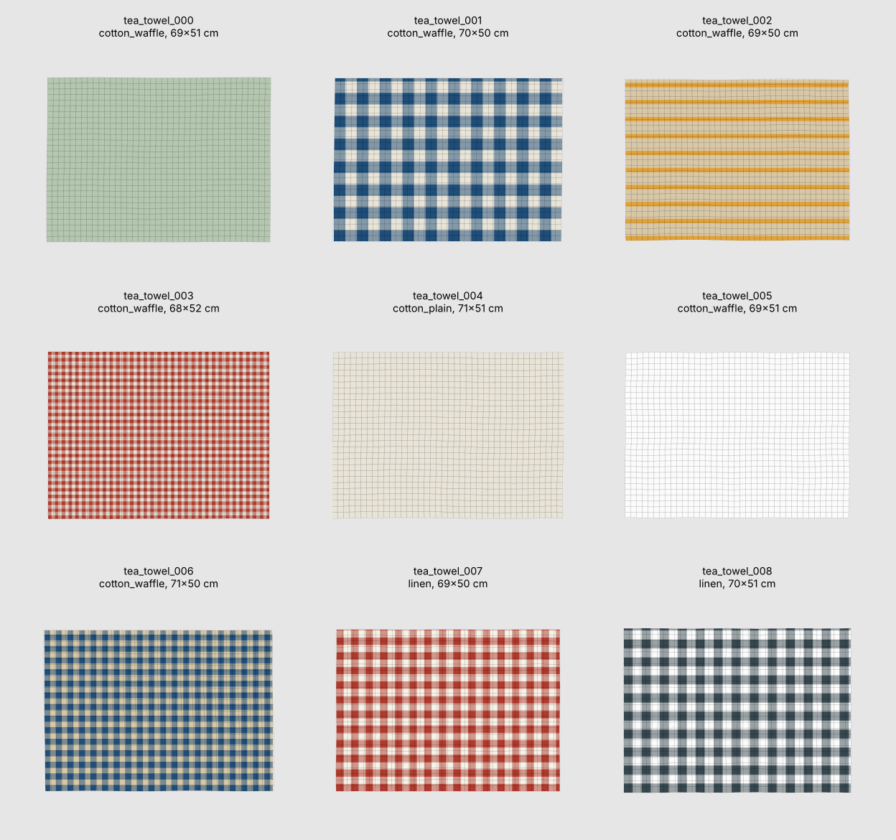

# Usage in depth

The preset list, fabrics, formats, mesh options and how a piece is built.

Part of the [Maillage](../README.md) documentation.

## Presets

| Category | Preset | Formats (cm) | Fabrics |
|---|---|---|---|
| Bath | `bath_towel` | 70×140, 90×150 | cotton terry |
| | `hand_towel` | 50×100, 40×60 | cotton terry |
| | `washcloth` | 30×30 | cotton terry |
| Kitchen | `tea_towel` | 50×70, 45×65 | waffle cotton, linen, plain cotton |
| Table | `napkin` | 40×40, 50×50 | linen, plain cotton |
| | `tablecloth` | 140×180, 140×240, round ⌀150, oval 140×200 | plain cotton, linen |
| Bedding | `bed_sheet` | 180×290, 240×300, 270×310 | percale, linen |
| Cleaning | `microfiber_cloth` | 40×40, 30×30 | microfiber |
| Accessories | `bandana` | 55×55 | plain cotton |
| | `silk_scarf` | 90×90, 50×160 | silk |
| | `scarf` | 25×160, 30×180, 20×140 (knitted winter scarf) | wool knit |
| Outdoor | `flag` | 100×150, 60×90 (hung by the hoist) | polyester knit |

*One piece of each preset (seed 2), simulated 5 s by the Blender drape test
and rendered with Cycles; each image is framed on its own piece, so scales
differ (30 cm washcloth to 3 m sheet). Same colours for the three terry
presets: they share a palette and, with one seed, the same colour draw.*

Sizes are common retail formats; values are realistic orders of magnitude,
not measurements of a specific product. Flags use generic two or three band
designs with random colours on unequal, asymmetric bands, so that real
national flags (equal or symmetric bands) are unlikely.

## Fabrics

| Fabric | Areal density | Thickness | Friction |
|---|---|---|---|
| `cotton_terry` | 450 g/m² | 4 mm | 0.8 |
| `cotton_waffle` | 220 g/m² | 1.5 mm | 0.6 |
| `cotton_plain` | 140 g/m² | 0.3 mm | 0.5 |
| `cotton_percale` | 120 g/m² | 0.25 mm | 0.5 |
| `linen` | 180 g/m² | 0.35 mm | 0.55 |
| `denim` | 400 g/m² | 0.7 mm | 0.6 |
| `fleece` | 250 g/m² | 3 mm | 0.8 |
| `microfiber` | 300 g/m² | 2 mm | 0.9 |
| `polyester_knit` | 115 g/m² | 0.2 mm | 0.4 |
| `silk` | 60 g/m² | 0.1 mm | 0.3 |
| `wool_knit` | 350 g/m² | 3 mm | 0.7 |

`--fabric` gives every piece the same fabric, whatever the preset's mix.

## Formats

Each preset draws from its own retail formats (table above). `--format`
(Python: `formats=`) replaces them with your sizes and shapes, in cm, as a
comma-separated list:

| Format | Shape |
|---|---|
| `50x70` (or `rect:50x70`, `50×70`) | rectangle, 50 × 70 cm |
| `oval:140x200` (or `ellipse:140x200`) | ellipse, 140 × 200 cm |
| `round:150` | circle, 150 cm in diameter |
| `50x70@3` | any of the above with a weight (here 3; 1 when there is no `@`) |

**Weights.** Each piece draws one format at random, with a probability
proportional to its weight: weight / sum of the weights. With
`--format "140x180@2,round:150,oval:140x220"` the weights are 2, 1 and 1
(sum 4), so each tablecloth has a 50 % chance of being 140×180, 25 % of being
round and 25 % of being oval: about 6, 3 and 3 out of 12 on average, the exact
counts depending on the seed. Only the ratios matter (`@2`, `@1`, `@1` is the
same as `@50`, `@25`, `@25`), and without any `@` all formats are equally
likely. With `--no-size`, nothing is drawn: every piece takes the first format
of the list, at its exact size. The presets' own formats use the same weights
(a `bath_towel` is 70×140 with weight 0.7, 90×150 with weight 0.3).

The longer side is always the length, so `70x50` is the same as `50x70`. The
preset's size tolerance, cut, corners, fabric and patterns still apply. In
Python, a format can also be a dict (`{"width": 50, "length": 70, "shape":
"rect", "weight": 1}`) or a tuple (`(50, 70)`, `(150, 150, "round")`). With
`--topology grid`, round and oval formats are skipped (at least one rectangle
is needed). `manifest.json` counts the pieces of each format drawn, in its
summary.

## Mesh

| Option | Default | Effect |
|---|---|---|
| `--topology tri` | ✓ | near-equilateral triangles (Delaunay on a jittered hexagonal lattice, outline sampled at the same spacing); any outline; minimum angles above ~20° |
| `--topology grid` | | structured quads stretched over the four cut edges (Coons patch); rectangles only, sharp corners; round formats are skipped |
| `--vertices N` | 1500 | target vertices per piece, whatever its size |
| `--count N`, `--seed S` | 12, 1 | number of pieces, random seed; same options and seed give the same pieces |

*`maillage preview output/tea_towel` on a grid-topology set: the texture is
drawn over each piece and the mesh shown on top; the wavy grid lines are the
imperfect cut, spread across the piece.*

## Method in brief

1. **Outline.** A rectangle with rounded corners or an ellipse, parametrised
   by arc length. The cut adds a smooth normal displacement (sum of a few
   sines along the perimeter: long gentle deviations plus a small wobble) and
   a slight shear.
2. **Mesh.** *tri*: the outline is sampled at the target edge length (sharp
   corners kept, roundings below the resolution merged into one vertex), the
   inside filled with a jittered hexagonal lattice kept at least half an edge
   away from the outline, then a Delaunay triangulation clipped to the
   outline. *grid*: transfinite (Coons) interpolation of the four cut edges.
3. **Fabric and mass.** The fabric is drawn from the preset's mix; the mass is
   the measured area times the areal density.
4. **Hem and pins.** Vertices within the hem width of the outline get
   `hem = 1`; for flags, vertices near the two hoist corners get `pin = 1`.
5. **Pattern.** Parameters drawn per piece (colours from the preset's
   palettes, periods, band widths), rendered on the nominal rectangle with a
   faint weave noise; texture coordinates follow the fabric, so a skewed or
   wavy cut shows as a pattern not quite parallel to the edge, as on real
   pieces.
